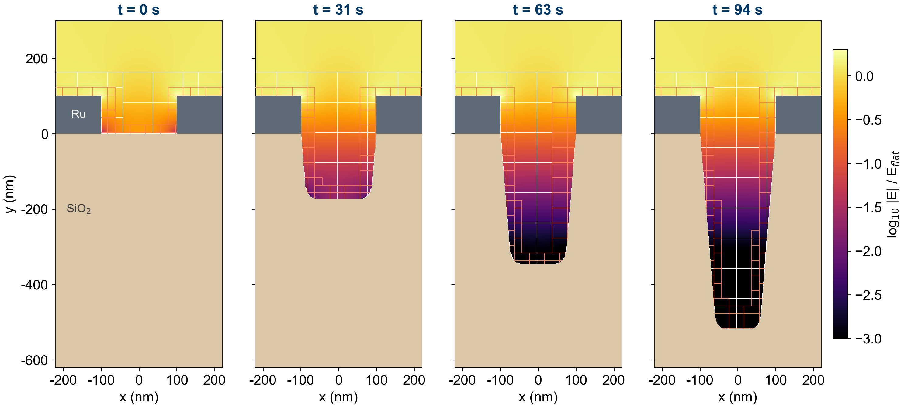

# Laplace_2D_Trench_Etch — a trench etched in one run

## Purpose

This case checks the mid-run geometry change (`vidyut.geom_switch_steps`). A
trench is cut into a masked SiO2 surface in three stages within one run. At
each stage the immersed boundary is rebuilt on every level and the refined
patches move with the etch front.

The pass condition is exact. After the last switch, the run must match a
separate run that has the final trench from step 0. That means the same grid
hierarchy, the same cell mask, and potential differences at round-off.

The etch depths are **prescribed**. No surface chemistry or etch rate is solved.
This is a geometry test, not an etch model.

## Files

| File | Role |
|---|---|
| `inputs2d` | Staged run: `eb2.etch_stages = 3`, `vidyut.geom_switch_steps = 4 8 12` |
| `Prob.H` | `TrenchIF`: Ru mask over an SiO2 substrate with a tapered, round-bottomed trench |
| `UserFunctions.H` | Constant wall and box values (mask and substrate grounded, top `phi = 1`) |
| `run_etch.sh` | Runs the staged and the static case, then `compare_switch.py` |
| `compare_switch.py` | Compares the grids, `cellmask` and fields of the last plotfiles of two runs |
| `fig_etch_trench.py` | Draws `trench_etch.png` from the staged run |

## Geometry and inputs

Units are 100 nm. The box is `[-3.23, 3.17] x [-7.97, 4.83]`, offset so that no
wall sits on a grid line. The base grid is 128 x 256 with 2 levels of
`vidyut.refine_cutcells = 1` refinement and `amr.n_error_buf = 8`.

| Input | Default | Effect |
|---|---|---|
| `eb2.etch_stages` | 0 | Number of etch stages. 0 keeps `eb2.trench_depth` and `eb2.trench_wbot` fixed. Must be >= 0 |
| `eb2.final_depth` | 5.2 | Depth after the last stage. Depth = `final_depth * min(phase, stages) / stages`. Must be > 0 |
| `eb2.final_wbot` | 1.16 | Bottom width after the last stage; tapers linearly from `eb2.trench_wtop`. Must be in (0, `trench_wtop`] |
| `eb2.trench_depth`, `eb2.trench_wbot` | 0, 2.0 | Fixed depth and bottom width; used only when `eb2.etch_stages = 0`. Must be >= 0 and in (0, `trench_wtop`] |
| `eb2.trench_wtop` | 2.0 | Opening width at the mask. Must be > 0 |
| `eb2.mask_height` | 1.0 | Thickness of the mask. Must be > 0 |
| `eb2.bottom_radius` | 0.3 | Radius of the rounded bottom corners. Must be >= 0 |
| `vidyut.geom_switch_steps` | none | Before each listed step, `vidyut.geom_phase` is advanced by one and the geometry rebuilt. Must be >= 1 and strictly increasing; needs an EB build and `vidyut.using_ib = 1` |
| `vidyut.geom_phase` | 0 | Starting phase. Must be >= 0. Stored in each checkpoint (file `GeomPhase`) and restored on restart |

Each of these is range checked and aborts with a message that names the input.
A switch at step 4 happens after four steps are complete: the log prints it
right after "Coarse STEP 5 starts".

## Data and acknowledgements

The trench dimensions follow Fig. 2 of

> F. Rodrigues, L. F. Aguinsky, C. Lenz, A. Hössinger and J. Weinbub,
> "3D modeling of feature-scale fluorocarbon plasma etching in silica",
> *J. Comput. Electron.* **22**, 1558 (2023),
> https://doi.org/10.1007/s10825-023-02068-y (CC BY 4.0).

The dimensions used are a 200 nm mask opening, a 100 nm Ru mask, and a final
depth of 520 nm with a 116 nm bottom width after 94 s. We thank the authors for
an open-access paper. No data from the paper are redistributed here; only the
published dimensions are used. The figure times (0, 31, 63, 94 s) come from the
paper's 332 nm/min rate.

## How to run

    make -j USE_MPI=TRUE USE_EB=TRUE
    ./run_etch.sh
    python3 fig_etch_trench.py trench_etch.png runs/staged/plt00003:0:0 \
        runs/staged/plt00007:1.7333333:31 runs/staged/plt00011:3.4666667:63 \
        runs/staged/plt00016:5.2:94

The three runs (staged, static, restart) take a few seconds each on 4 ranks.

## Expected results

`compare_switch.py runs/final runs/staged`:

| Quantity | Result |
|---|---|
| Grids, all levels | identical (194 grids) |
| Cells with a different `cellmask` | 0 |
| Potential, max relative difference | 1.1e-16 |
| Electric field, max relative difference | 1.7e-15 |
| Restarted at step 6 vs uninterrupted | identical (`fcompare`, zero tolerance) |

The staged depth is computed from the final depth (`5.2 * 3/3`), not summed
from per-stage increments. A summed version (`3 x 1.7333333`) left 37 cut cells
with volume fractions different by up to 1.7e-4 and a potential difference of
8.9e-12.

A third run restarts the staged run from its step-6 checkpoint, between the
first and second switch. Each checkpoint stores `vidyut.geom_phase` (file
`GeomPhase`), and a restart uses it. If the restart deck's
`vidyut.geom_switch_steps` imply a different phase, the run aborts. A
checkpoint without the file (written before this change) falls back to
counting the switch steps already passed. The restarted run must match the
uninterrupted one exactly (`fcompare` with zero tolerance), and it does.

This restart check found a fault in the fill of newly fluid cells
(`rebuild_level_geometry`, from aa756ab). The ghost cells of the per-sweep state
snapshot were never set on domain faces and coarse-fine boundaries, so the fill
could take a donor value from uninitialised memory. The uninterrupted run did
not show it. After a restart the heap differed, and the electron density came
out as 0 and `inf` in about 600 cells. The snapshot ghosts are now set to
"solid" once. With them set to "donor" instead (the worst case for
uninitialised memory), the staged run writes `inf` and `fcompare` fails.

Each cell that turns from solid to gas takes the average of its gas
neighbours. The fill moves inward one cell per sweep. It was capped at 32
sweeps, and each etch stage here opens about 35 coarse cells, so 76 cells per
stage were left with the case's initial value and the log printed "no fluid
neighbour". The sweep now runs until every new cell is filled. It stops early
only when a sweep fills nothing, which means the remaining cells have no gas
neighbour at all. The run now prints no such warning, and CI fails if it does.
The results here do not change, because this case starts every cell at the
same density.

The deck sets `amr.regrid_int = 1000000`, so only the geometry switch can move
the refined patches. With the default `amr.regrid_int = 1`, the regrid at the
next step repairs a switch that builds the wrong hierarchy, and the test cannot
see it. This was checked with a one-line mutant: one `regrid` per switch instead
of `max_level`. With per-step regrids the mutant passed. With the deck as given,
`fcompare` stops with "grids do not match at level 2".

## CTest

There is no CTest in this repository. The case runs in the GitHub CI workflow
(`.github/workflows/testvidyut.yml`, EB build, 2 ranks). The staged and static
runs are compared with AMReX `fcompare -r 1e-12`, which fails if the grids
differ or any field, `cellmask` included, differs by more than 1e-12. `run_etch.sh`
does the same when `fcompare` is built (or `FCOMPARE=<path>` is set), and then
prints the gas-cell differences with `compare_switch.py` (needs yt).
