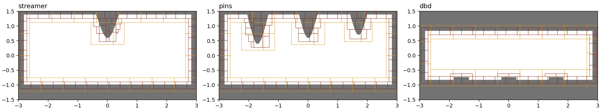

# MMS2_AMR_Applications — local refinement on three discharge geometries

## Purpose

This case checks static refinement of cut cells on three geometries where
refinement near walls is expected to help:

- **streamer**: one needle above a grounded plane.
- **pins**: three needles of different heights above a plane.
- **dbd**: two flat plates with thin strips on the lower one, as in a barrier
  discharge.

The coupled transport equations (potential, ions, electrons, electron energy)
are solved with the MMS2-type manufactured solution. Each run is compared with
uniform grids of 256x128, 512x256 and 1024x512. The AMR runs use a 256x128 base
grid and two levels, so their finest spacing matches the 1024x512 grid.

These are verification cases. All walls are Dirichlet from the exact solution.
No dielectric charging, secondary emission or other surface physics is modelled.

## Files

| File | Role |
|---|---|
| `inputs_streamer`, `inputs_pins`, `inputs_dbd` | One deck per geometry |
| `AppGeom.H` | Implicit functions of the three geometries and their inputs |
| `Prob.H`, `UserSources.H`, `UserFunctions.H` | MMS2-type exact solution, sources and wall values |
| `run_case.sh` | Runs the uniform and AMR ladders for one geometry |
| `mms_errors.py` | Relative L2 and Linf errors of the last plotfile of each run (needs yt) |
| `plot_geometry.py` | Draws `amr_applications.png` |

## Manufactured solution

$$
\phi = \frac{r^4}{32}, \qquad
n_i = \frac{r^2}{2\alpha} + n_0, \qquad
n_e = n_\varepsilon = \frac{r^2}{\alpha} + n_0,
$$

with $r^2 = x^2 + y^2$, $\alpha = e/\varepsilon_0$ and $n_0 = 10^6$. The
electron temperature is frozen (`vidyut.freeze_etemp = 1`). Errors are taken
over gas cells (`cellmask = 1`) that are not covered by a finer level, area
weighted, and divided by the largest exact value on those cells.

## Geometry and inputs

Domain `[-3,3] x [-1.5,1.5]`. Every geometry sits inside a box chamber
(`app_ch_*`), so no wall is a domain face. Dimensions are in the decks; the
smallest features are the needle tip radius (0.06 for streamer, 0.04 for pins)
and the strip height (0.086 for dbd), about 2–4 cells on the 256x128 grid.

| Input | Default | Effect |
|---|---|---|
| `eb2.app_type` | none | `streamer`, `pins` or `dbd`; anything else aborts |
| `eb2.app_ch_x`, `app_ch_y0`, `app_ch_y1` | none | Chamber box, gas inside. Needs `app_ch_x > 0`, `app_ch_y0 < app_ch_y1` |
| `eb2.app_plane_y` | none | Grounded plane (streamer, pins). Must lie inside the chamber |
| `eb2.app_pin_x`, `app_pin_ytip` | none | Needle positions and tip heights. One needle for streamer, up to 8 for pins |
| `eb2.app_tip_r` | none | Tip radius of curvature. Must be > 0 |
| `eb2.app_half_angle` | none | Needle half angle in degrees. Must be in (0, 60) |
| `eb2.app_plate_y0`, `app_plate_y1` | none | DBD plates: solid below `y0` and above `y1` |
| `eb2.app_strip_h` | none | Strip height on the lower plate. Must be > 0 |
| `eb2.app_strips` | none | Strip edges as pairs `x0 x1` |

Each check aborts with a message that names the input. The AMR settings are in
`run_case.sh`: `amr.max_level=2`, `amr.blocking_factor=8`,
`amr.n_error_buf=8`, `vidyut.refine_cutcells=1`, `prob.cmask_vfrac=1`,
`vidyut.ib_identity_rows=1`, and no periodic regrid.

## How to run

    make -j USE_MPI=TRUE USE_EB=TRUE
    ./run_case.sh pins            # u256 u512 u1024 amr, 8 ranks, 960 steps
    python3 mms_errors.py runs/pins/u256 runs/pins/u512 runs/pins/u1024 runs/pins/amr
    python3 plot_geometry.py amr_applications.png runs/streamer/amr runs/pins/amr runs/dbd/amr

`NP` and `STEPS` set the rank count and step count. The runs are steady by step
960: pins at 256x128 gives the same errors at 960, 1920 and 3840 steps.

## Expected results

Relative errors at step 960. "Cells" counts the cells in all grids that contain
gas, summed over levels. Times are wall-clock seconds on 8 ranks of an Apple M
laptop. The streamer times are not comparable with each other, because other
jobs shared the machine during those runs.

| Case | Run | Cells | Time (s) | φ L2 | φ Linf | n_i L2 | n_i Linf | n_e L2 | n_e Linf |
|---|---|---|---|---|---|---|---|---|---|
| streamer | u256 | 32768 | 119 | 4.32e-5 | 8.19e-5 | 1.82e-4 | 6.16e-4 | 4.52e-5 | 4.77e-4 |
| | u512 | 131072 | (2282) | 2.84e-5 | 5.00e-5 | 7.53e-5 | 1.67e-4 | 1.43e-5 | 1.03e-4 |
| | u1024 | 458752 | (2525) | 3.16e-6 | 6.01e-6 | 1.35e-5 | 3.93e-5 | 2.64e-6 | 3.09e-5 |
| | **AMR** | 207168 | 498 | **1.32e-5** | 3.79e-5 | **3.23e-5** | 9.17e-5 | **1.06e-5** | 8.14e-5 |
| pins | u256 | 32768 | 35 | 3.72e-5 | 7.74e-5 | 1.63e-4 | 6.16e-4 | 4.11e-5 | 4.77e-4 |
| | u512 | 131072 | 260 | 2.09e-5 | 4.26e-5 | 6.62e-5 | 1.67e-4 | 1.16e-5 | 1.03e-4 |
| | u1024 | 450560 | 2114 | 2.49e-6 | 5.20e-6 | 1.20e-5 | 3.93e-5 | 2.05e-6 | 3.09e-5 |
| | **AMR** | 249408 | 203 | **1.12e-5** | 4.16e-5 | **2.82e-5** | 9.38e-5 | **1.24e-5** | 8.73e-5 |
| dbd | u256 | 32768 | 26 | 2.17e-5 | 4.73e-5 | 1.48e-4 | 5.43e-4 | 3.92e-5 | 4.18e-4 |
| | u512 | 131072 | 178 | 1.77e-5 | 3.74e-5 | 6.15e-5 | 1.78e-4 | 1.16e-5 | 9.15e-5 |
| | u1024 | 393216 | 2015 | 1.56e-6 | 3.09e-6 | 1.10e-5 | 3.45e-5 | 1.78e-6 | 2.69e-5 |
| | **AMR** | 189440 | 134 | **1.02e-5** | 4.66e-5 | **2.54e-5** | 8.82e-5 | **1.14e-5** | 7.36e-5 |

What the table shows:

- The AMR runs cost about as much as the 512x256 grid (pins 203 s against
  260 s, dbd 134 s against 178 s).
- In L2 they are 1.7–2.4x more accurate than 512x256 for the potential and the
  ions. For the electrons they are about equal to 512x256 (0.94–1.35x; for
  pins slightly worse, 1.24e-5 against 1.16e-5).
- They do not reach the 1024x512 grid. In the max norm they are close to
  512x256 for streamer and pins, and 25% worse in φ for dbd.
- For pins, the largest AMR error in φ and n_i sits on the 256x128 base grid
  at about (-2.6, 1.0), near the upper-left chamber corner and just outside
  the refined band. The solution `r^4/32` has its largest fourth
  derivative at large `r`, so the base grid's own truncation error there sets
  the max norm. Refinement next to the walls cannot remove it. This is the
  limit described in `Laplace_2D_Posts/README.md`; with a harmonic solution
  that limit would not apply.

Uniform-grid convergence of the potential is not smooth. For pins, extra runs at
384x192 and 768x384 give:

| pins uniform | 256 | 384 | 512 | 768 | 1024 |
|---|---|---|---|---|---|
| φ Linf | 7.74e-5 | 4.85e-5 | 4.26e-5 | 7.94e-6 | 5.20e-6 |
| n_i Linf | 6.16e-4 | 2.40e-4 | 1.67e-4 | 6.09e-5 | 3.93e-5 |

Neither the potential nor the ion density converges at a steady rate.
From 256 to 512 the order is 0.3–0.9 for φ and about 1.3 for n_i (L2, all
three cases). From 512 to 1024 it is 3.0–3.6 for φ. Over the whole range 256
to 1024 the average order is 1.9–2.2 for every field, and that is the only
figure quoted here. The φ plateau between 384 and 512 has not been
explained. All three geometries show the low order from 256 to 512, including
dbd, which has no needle tip, so the tip radius alone does not account for it.

The electron-energy errors are not in the table: in every run they equal the
electron-density errors to three significant figures (`mms_errors.py`
prints both). The exact profiles of the two are the same.

## Data and acknowledgements

No external data are used.

## CTest

There is no CTest in this repository, and these runs are too long for CI (the
1024x512 runs take about 35 minutes each on 8 ranks). The geometry code is
compiled in the EB build of this case only.
