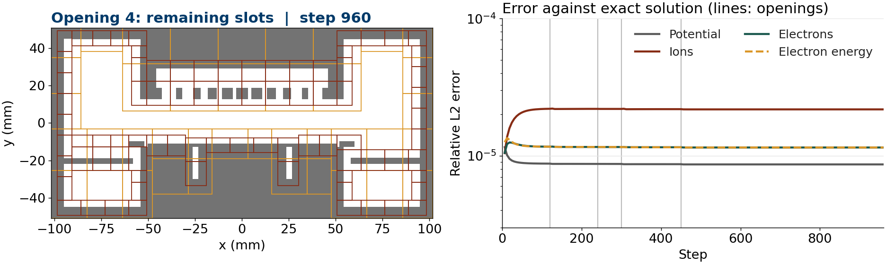

# MMS2_AMR_Showerhead — showerhead slots opening during a run

## Purpose

This case checks mid-run geometry change in a full chamber with the coupled
transport equations and local refinement. The chamber has a showerhead with a
plenum and ten slots, a pedestal with lift-pin holes, a wafer, a focus ring and
a confinement ring with a pump gap.

In the staged run the plenum is present from the start, and the slots open in
four groups at steps 120, 240, 300 and 450. At each opening the immersed
boundary is rebuilt on every level, newly opened cells are filled from their gas
neighbours, and the refined patches follow the new walls.

The pass condition: at step 960 the staged run equals a run that has every slot
open from step 0. The two runs share the same steady discrete solution, so they
must agree at the solver tolerance.

This is a verification case. All walls are Dirichlet from the exact solution.

## Files

| File | Role |
|---|---|
| `inputs` | Deck (planar 2D, 256x128 base) |
| `CompositeGeom.H` | Implicit function of the chamber and its inputs |
| `Prob.H`, `UserSources.H`, `UserFunctions.H` | MMS2-type exact solution, sources and wall values |
| `run_staged.sh` | Runs "final" (all slots open) and "staged" (four openings) with 2 AMR levels |
| `compare_switch.py` | Grids, `cellmask` and field differences of the last plotfiles of two runs |
| `make_movie_errors.py` | Movie of the staged run with its error history; also writes the last frame |

## Manufactured solution

The same as `MMS2_AMR_Applications`:

$$
\phi = \frac{r^4}{32}, \qquad
n_i = \frac{r^2}{2\alpha} + n_0, \qquad
n_e = n_\varepsilon = \frac{r^2}{\alpha} + n_0,
$$

with $\alpha = e/\varepsilon_0$, $n_0 = 10^6$ and the electron temperature
frozen (`vidyut.freeze_etemp = 1`). The chamber is drawn in metres and scaled
by `eb2.comp_scale` into the `[-3,3] x [-1.5,1.5]` domain.

## Inputs

| Input | Default | Effect |
|---|---|---|
| `eb2.comp_slot_phase` | all 0 | One value per slot. Slot `s` is open once `vidyut.geom_phase >= comp_slot_phase[s]`. Must be >= 0, one per slot |
| `vidyut.geom_switch_steps` | none | Steps before which `vidyut.geom_phase` is advanced by one and the geometry rebuilt. Must be >= 1 and strictly increasing; needs an EB build and `vidyut.using_ib = 1` |
| `vidyut.geom_phase` | 0 | Starting phase. Must be >= 0. Stored in each checkpoint and restored on restart |
| `eb2.comp_showerhead`, `comp_pins_on`, `comp_wafer`, `comp_ring`, `comp_conf`, `comp_chamber` | 1, 1, 1, 1, 1, 0 | Include each part. Must be 0 or 1 |
| `eb2.comp_after_*` | as above | The same switches, applied from `geom_phase >= 1`. Must be 0 or 1, checked at start-up |
| `eb2.comp_scale` | 1 | Length scale applied to every dimension. Must be > 0 |
| `eb2.comp_ch_x`, `comp_ch_y0`, `comp_ch_y1` | none | Chamber box when `comp_chamber = 1`. Needs `comp_ch_x > 0` and `comp_ch_y0 < comp_ch_y1` |

Each check aborts with a message that names the input. The staged run uses
`eb2.comp_slot_phase = 1 1 4 4 2 2 4 4 3 3` and
`vidyut.geom_switch_steps = 120 240 300 450` (set in `run_staged.sh`).

## How to run

    make -j USE_MPI=TRUE USE_EB=TRUE
    ./run_staged.sh                       # 8 ranks, two runs of 960 steps
    python3 compare_switch.py runs/final runs/staged
    python3 make_movie_errors.py runs/staged runs/showerhead_staged.mp4 6 120 240 300 450

Each run takes about 3 minutes on 8 ranks.

## Expected results

`compare_switch.py runs/final runs/staged`:

| Quantity | Result |
|---|---|
| Grids, all levels | identical (129 grids) |
| Cells with a different `cellmask` | 0 |
| Potential, max relative difference | 2.3e-10 |
| Electric field, max relative difference | 1.9e-9 |
| Electron and ion density, max relative difference | 3.9e-9, 7.3e-9 |

The two runs reach the steady state by different paths, and what is left is
set by the linear-solver tolerance:

| Check | φ | n_i |
|---|---|---|
| step 960, `vidyut.linsolve_reltol = 1e-12` (deck) | 2.3e-10 | 7.3e-9 |
| step 1920, same tolerance | 2.3e-10 | 7.3e-9 |
| step 960, `linsolve_reltol = 1e-14`, `linsolve_abstol = 1e-16` | 1.4e-12 | 2.3e-11 |

The difference does not decay with more steps, so it is not a transient. It
falls by about 160–310x when the solver tolerance is tightened 100x.

Errors against the exact solution at step 960 (the same for both runs):

| φ L2 | φ Linf | n_i L2 | n_i Linf | n_e L2 | n_e Linf |
|---|---|---|---|---|---|
| 8.65e-6 | 3.73e-5 | 2.18e-5 | 7.89e-5 | 1.15e-5 | 7.53e-5 |

The error history in the figure stays flat through all four openings. The
log prints no "no fluid neighbour" warning: every newly opened cell is filled
from its gas neighbours.

## Data and acknowledgements

No external data are used. The chamber layout is schematic and is not taken from
any published tool.

## CTest

There is no CTest in this repository, and the two runs are too long for CI. The
geometry-switch code path is tested in CI by `Laplace_2D_Trench_Etch`.
